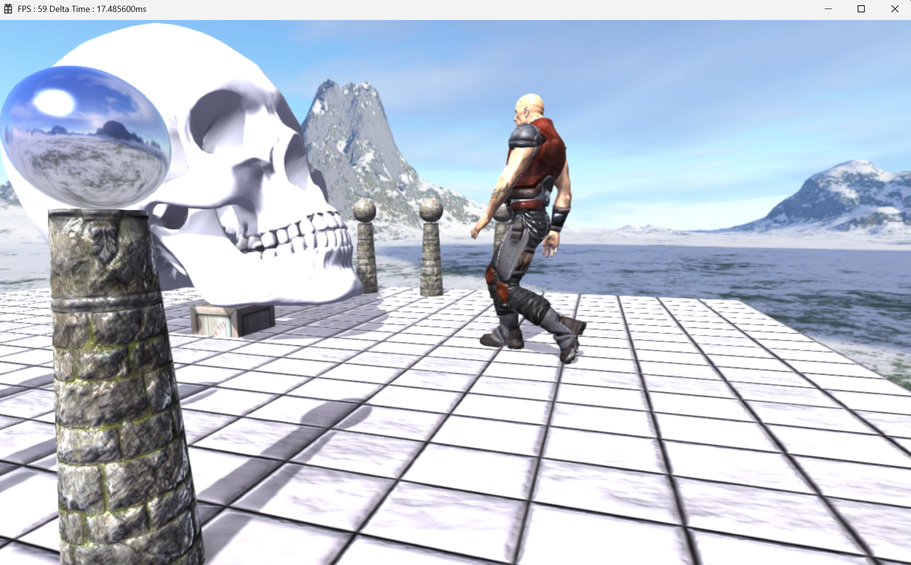
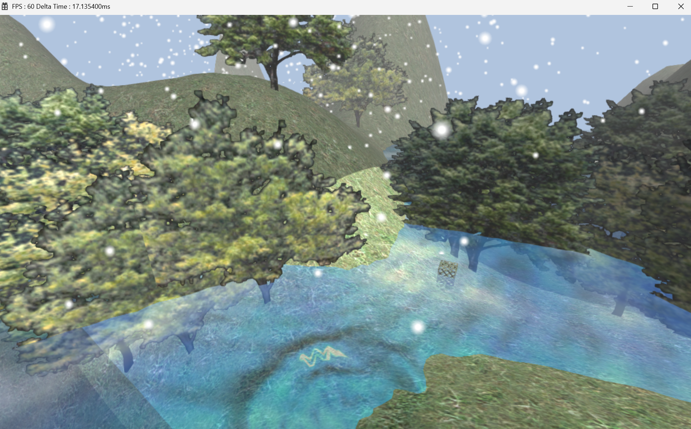

# LilyEngine_Version3 - 现代 3D 游戏引擎 (Modern 3D Game Engine)

  <b>基于 C++17 与 DirectX 12 从零手写的模块化现代图形引擎。不依赖任何商业引擎黑盒，旨在深度探索 GPU 硬件底层、现代图形管线与引擎架构设计。</b>

 

---

##  渲染效果展示 (Gallery)

  
   
  <i>场景渲染展示：材质, 阴影, SSAO 与动画</i>

  
   
  <i>场景渲染展示：水面与粒子</i>

---

##  核心特性 (Key Features)

### 图形与渲染 (Graphics & Rendering)
*   **底层 API 封装**：深度封装 DirectX 12，实现根签名（Root Signature）、管线状态对象（PSO）与描述符堆（Descriptor Heap）的高效管理。
*   **高级光照与阴影**：实现基于 PCF（Percentage-Closer Filtering）的 Shadow Map 软阴影系统；支持法线贴图（Normal Mapping）及切线空间的光照计算。
*   **屏幕空间技术**：基于 G-Buffer 实现 **SSAO**（屏幕空间环境光遮蔽），并配合双边滤波（Bilateral Blur）进行降噪。
*   **后处理管线**：集成 FXAA 抗锯齿机制。

### 动画系统 (Animation System)
*   **骨骼蒙皮动画**：自主解析 M3D 格式资产，在 CPU 端完成基于四元数（Quaternion）的插值与多级层级骨骼矩阵推导。
*   **GPU Skinning**：在顶点着色器中实现 4 权重骨骼蒙皮计算。
*   **数学空间对齐**：成功解决多级骨骼层级中的矩阵行/列主序（Row/Column Major）转置问题及法线逆转置（Inverse Transpose）变换，确保复杂动画下的光照正确。

### 引擎架构与资源管理 (Engine Architecture)
*   **内存管理**：自定义基于引用计数的智能指针模板（`Ptr`），替代裸指针，实现 Mesh/Material/Texture 等资源的自动生命周期管理与动态释放。
*   **资源池化**：使用 TexturePool 集中管理材质与纹理，优化显存分配，降低显存碎片。

---

## 构建与运行 (Build & Run)

### 环境要求 (Prerequisites)
*   **OS**: Windows 10 / 11 (x64)
*   **IDE**: Visual Studio 2022 (需安装“使用 C++ 的桌面开发”工作负载)
*   **SDK**: Windows 10/11 SDK, DirectX 12 Agility SDK